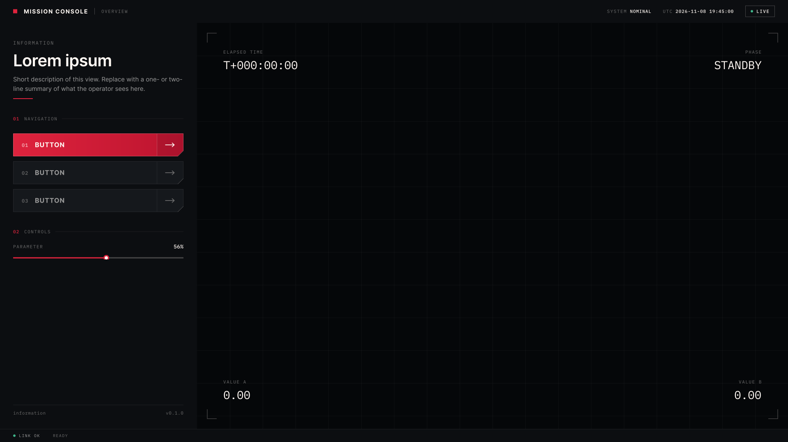

# Visual language

Source: [Figma frame](https://www.figma.com/design/xRsXzeKw6fl8MdyWuNOsxh/Untitled?node-id=10-78). Snapshot: [mission-console.png](assets/mission-console.png) ([svg](assets/mission-console.svg)). Tokens: [`src/tokens.css`](../src/tokens.css).

The app is a dark instrument panel with a map in the middle. It should read like a tool for a person in a spacesuit. Every pixel on screen is either the map or something the astronaut needs.

## Only show what carries information

This is the rule agents break most often, so it comes first.

The Figma frame is a template. Its placeholder labels are not part of the design. Don't build these:

| In the frame | Why it goes |
| --- | --- |
| OVERVIEW next to the logo | The page itself shows which view you're on. |
| INFORMATION above the title | The title is the information. |
| 01 NAVIGATION, 02 CONTROLS section headers | Buttons and sliders explain themselves. A group gets a header only when two groups would otherwise be confused. |
| 01, 02, 03 on buttons | Numbers mean order. Use them only where order is real, like route waypoints or EVA steps. |
| SYSTEM NOMINAL, LIVE, LINK OK, READY | There's no system behind them. Fake status is worse than none. |
| "information" and v0.1.0 in the sidebar footer | Nobody on Mars needs the build number. |

Before adding any label, badge, header or status, ask what the astronaut would do differently after reading it. If the answer is nothing, leave it out. Status indicators come back only when they show real state from real data, like the timestamp of the last weather reading.

Labels that do earn their place are the ones naming a value: Elapsed time, Slope, Dose rate. A number without its label is useless.

## Layout

Designed at 1920x1080.

- Top bar, 56px. Logo mark and product name on the left. Right side is free for things that matter, like the mission clock (UTC and local solar time).
- Sidebar, 480px, left. Title, short description, then the controls for the current view. 32px padding.
- Map canvas, the rest. Corner brackets frame it. Readouts pin to the corners.
- Status bar, 32px, bottom. Keep it only if it holds real state. Otherwise drop it and give the map the space.

The 80px grid on the canvas is a placeholder. The map replaces it. A faint grid can stay as an overlay if it maps to a real distance, like 100 m.

## Color

| Token | Value | Use |
| --- | --- | --- |
| `--color-bg` | `#050709` | Page and map background |
| `--color-surface` | `#0C0E11` | Top bar, sidebar |
| `--color-surface-raised` | `#15181C` | Buttons, cards |
| `--color-text` | `#FFF8F3` | Main text. Warm off-white, never `#FFF` |
| `--color-text-muted` | `#A8A8A8` | Descriptions, row labels |
| `--color-text-dim` | `#858585` | Value labels, units |
| `--color-line` | text at 8% | Dividers, idle borders |
| `--color-line-strong` | text at 24% | Active borders, slider track |
| `--color-accent` | `#D23CE6` to `#A3209F` | The primary action and the current selection |
| `--color-ok` | `#3FB68B` | Healthy, real status only |

The accent is magenta, the active-route color of aircraft navigation displays. It used to be Mars red. NASA-STD-3001 Vol 2 reserves red for the highest alert level [V2 10118] and yellow for the second [V2 10119], so red now means over a limit and nothing else. If something red on screen is not over a limit, it is wrong. Alerts also carry a shape, since color alone may not carry critical meaning [V2 10045].

Use `--color-warning` for missing map data or fallback imagery, with an explanation in text. It does not indicate a measured terrain hazard. `--text-section` is the smaller task heading in the site panel.

## Type

One family, Inter, in three weights: 400, 600 and 700. The first build paired it with JetBrains Mono, uppercase labels and wide tracking. A design review called all three out as marks of a generated UI, so they are gone. Don't bring them back.

| Role | Token | Size | Style |
| --- | --- | --- | --- |
| Title | `--text-title` | 40px | Bold |
| Readout | `--text-readout` | 28px | Regular |
| Section | `--text-section` | 22px | Regular or bold |
| Heading | `--text-heading` | 17px | Bold. Card and tab titles, the verdict |
| Body, big buttons | `--text-body`, `--text-button` | 15px | Regular. Buttons bold |
| Data | `--text-data` | 13px | Table numbers, small buttons, group headers at 600 |
| Value label, unit | `--text-label` | 12px | Regular, dim |

That is the whole scale. Component CSS uses the tokens, never a pixel size.

Numbers that change in place or line up in a column use tabular figures, `font-variant-numeric: tabular-nums`, so digits don't jump. Set it on the value, not on `body`, because it also widens hyphens in words.

No text is smaller than `--text-min`, 12px. NASA-STD-3001 Vol 2 [V2 10049] asks for characters of at least 0.25° of visual angle, and a CSS pixel is defined as 0.0213°, so 0.25° is about 12px.

Both text greys pass 4.5:1 on `--color-bg`, `--color-surface` and `--color-surface-raised`. Values are `--color-text`. Only labels and units are dim.

## Shape

- Square corners. No radius anywhere.
- 1px borders. No shadows, no blur, no glow.
- Primary buttons have a 12px clipped bottom-right corner. It's the one decorative detail, so don't add others.
- Corner brackets mark the edges of the map.

## Components in the frame

Button. 56px tall, full sidebar width, label left, a 64px arrow cell on the right. Primary uses the accent gradient. Secondary uses the raised surface with an 8% border.

Slider. The typed value in its box leads. Under it, with `--space-2` of room, a 2px track and a small square thumb for coarse changes.

Readout. Value label on top, the number below. Units go in the number line ("18°", "0.67 mSv/day"), not the label.

## Writing in the UI

Sentence case everywhere, labels and buttons included. Short readouts: "Slope 18°", not "Moderate terrain difficulty". No full sentences on the map. The `unslop` skill applies here too.

## Site inspection walkthrough

The interaction rules in [AGENTS.md](../AGENTS.md#human-interaction-principles) apply alongside this visual language. The site inspector opens with the site list visible. Selecting a site retains that selection; recentering and returning to the global view are separate actions. A check mark supplements the selected color. The footer grows to fit data failures and their retry action.

For this iteration, walk through these tasks with someone outside the implementation team:

- Select Curiosity, find its last recorded sol and position, and explain whether its track is a planned expedition. Repeat with a site without a track.
- Select the same site again, move the camera, recenter, and return to the globe. Check whether each action matches the user's expectation.
- Interrupt imagery or terrain loading. Identify what is missing, retry, and verify the selected site and camera view survive. Repeat with the older CTX mosaic selected automatically.
- Switch elevation scale to 3×. Ask what changed and whether the shaded terrain proves a slope is traversable.

Record completion, wrong interpretations, hesitation, and needed explanations. Check the collapsed panel, keyboard navigation, and a narrow display. These are evaluation scenarios, not evidence that astronaut usability has already been validated.

## References

Things worth looking at for ideas. Take ideas from them, not their look.

- [JPL Mars Trek](https://trek.nasa.gov/mars/). What Mars layers look like when stacked. Also an example of a UI built for scientists, not astronauts.
- [Curiosity's proposed path up Mount Sharp](https://science.nasa.gov/resource/curiositys-proposed-path-up-mount-sharp/). How NASA draws a route with labeled science regions.
- [NASA Eyes on the Solar System](https://eyes.nasa.gov/apps/solar-system/). Dark 3D space UI with minimal chrome.
- [NASA Graphics Standards Manual (1975)](https://www.nasa.gov/nasa-brand-center/). The worm-era design system. Short on decoration, strict grid, red as the one accent.
